# Inkhouse

A touch control panel for Home Assistant on a jailbroken Kindle. Big e-ink buttons for the things you actually use at home: air conditioning, the front door, the robot vacuum, the dishwasher, cameras, and a quiet status page.

**[Try the live demo](https://kingstonbenjamin.github.io/inkhouse/demo/)**, which is the real panel running on sample data in your browser.

| Control | House | Energy |
|---|---|---|
| 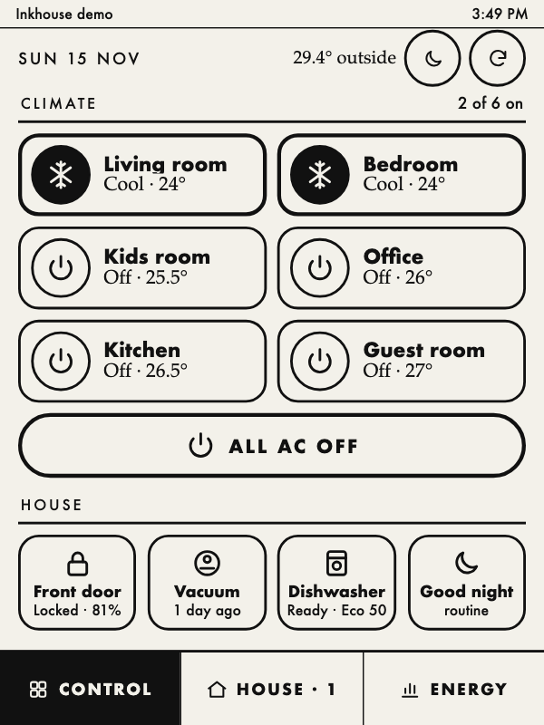 | 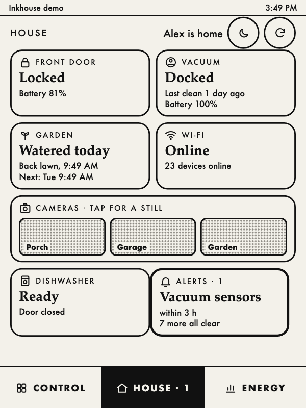 | 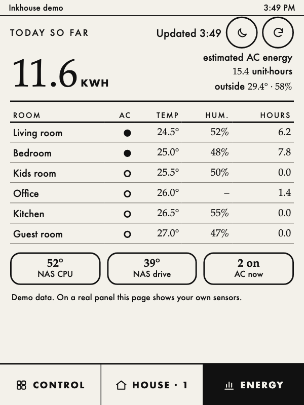 |

| Room sheet | Vacuum | Dishwasher | Alerts |
|---|---|---|---|
| 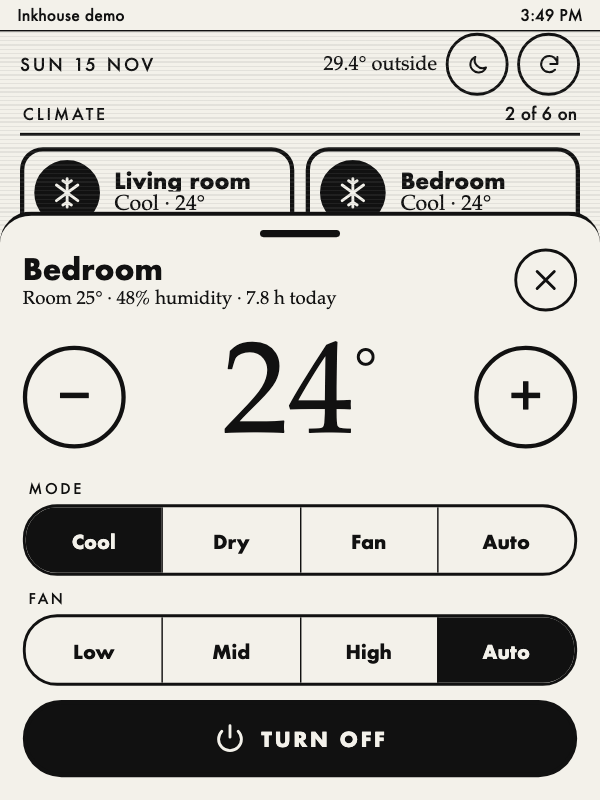 | 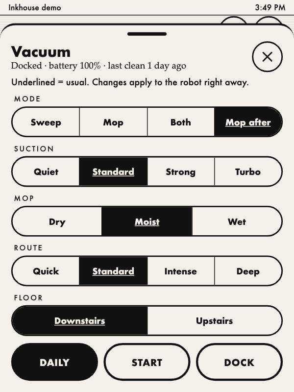 | 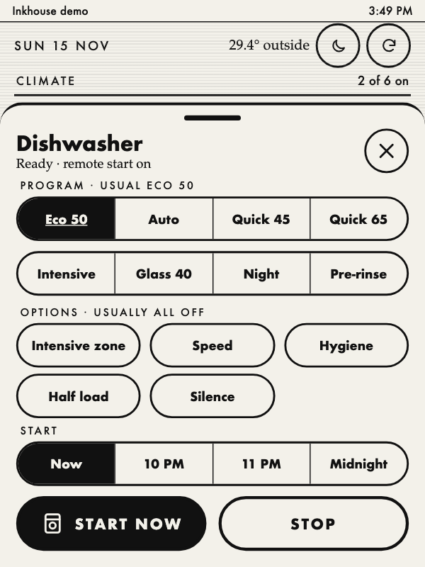 | 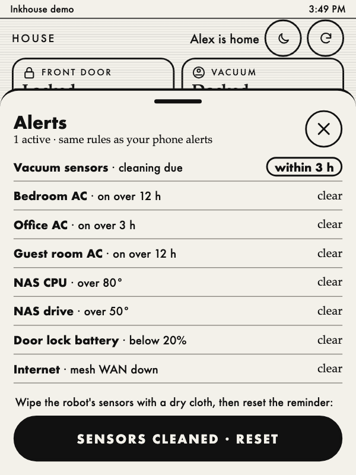 |

| Tap feedback | Half-degree steps | Confirm unlock | Confirm all off |
|---|---|---|---|
|  | 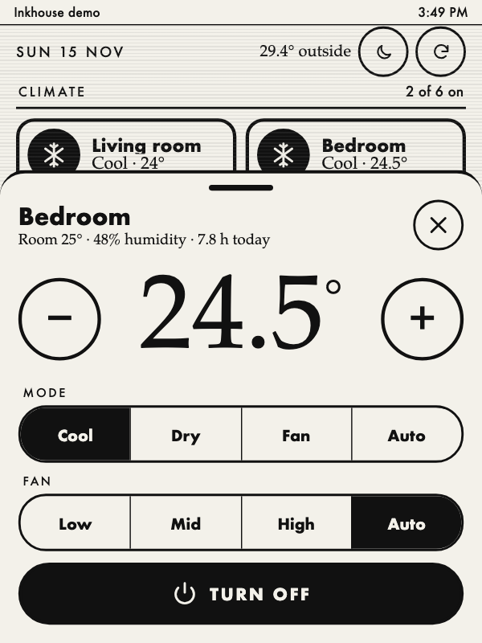 | 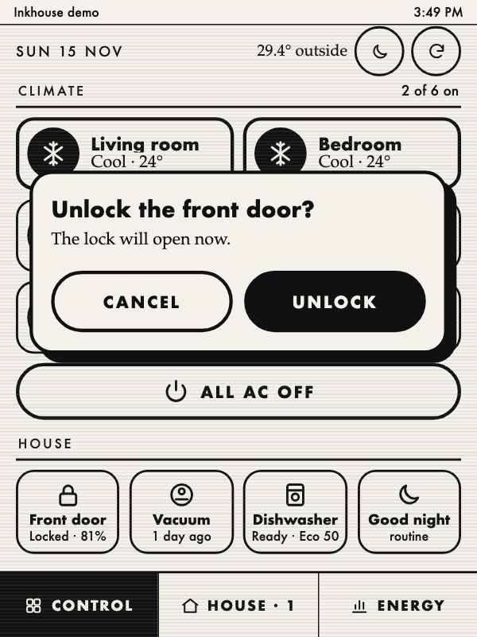 | 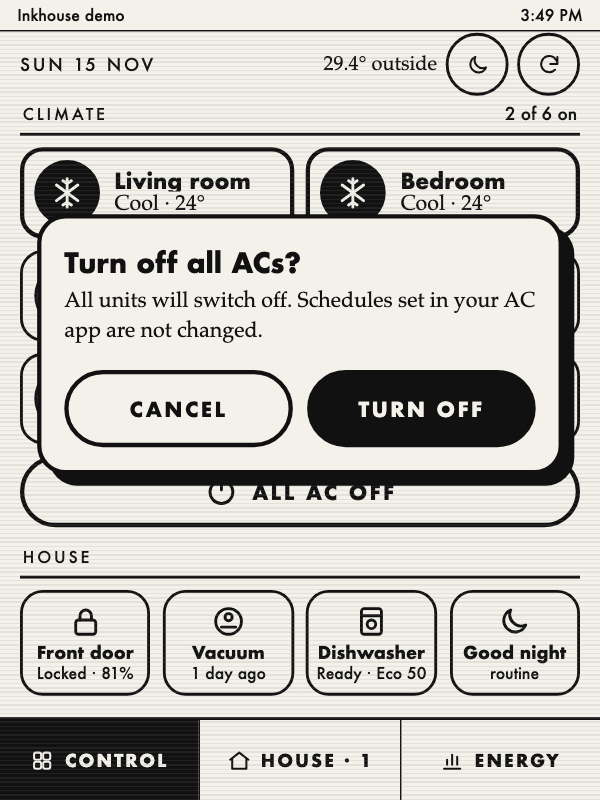 |

| Night mode | House at night | Idle clock | Idle clock at night |
|---|---|---|---|
| 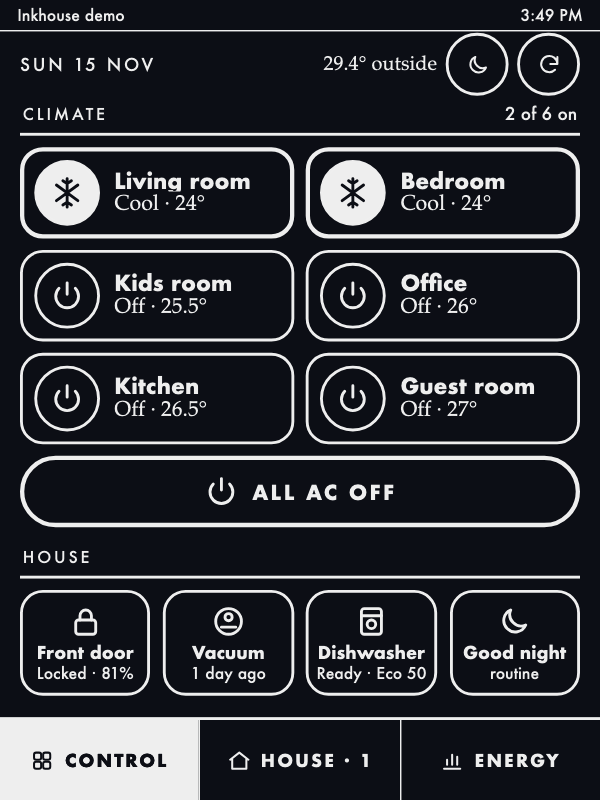 | 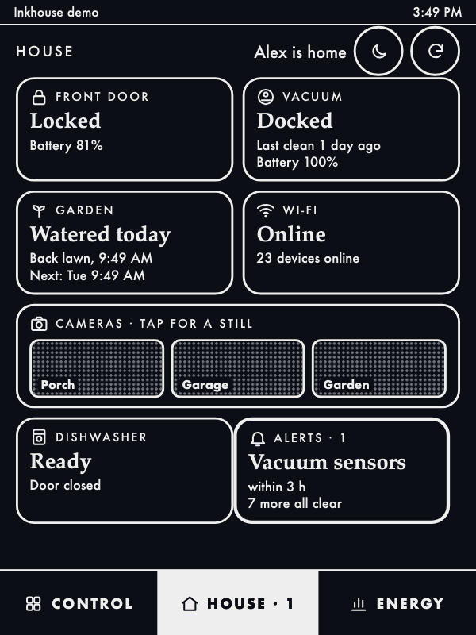 | 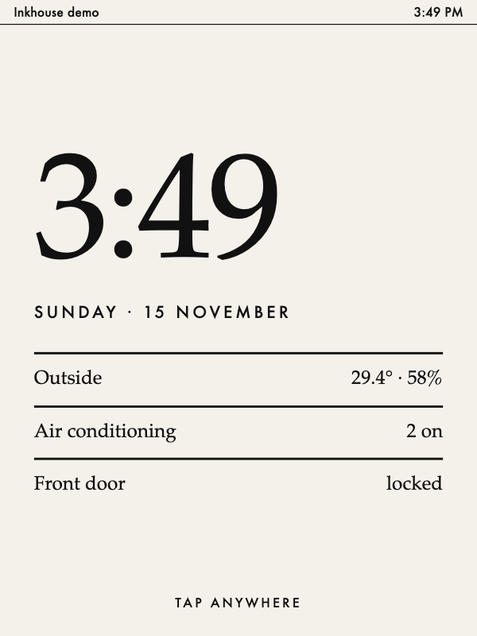 | 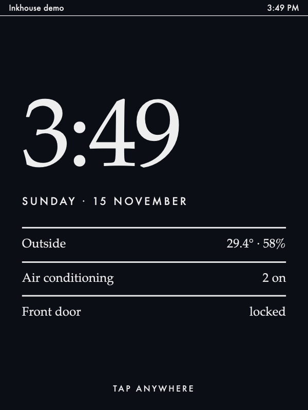 |

| Camera still |
|---|
| 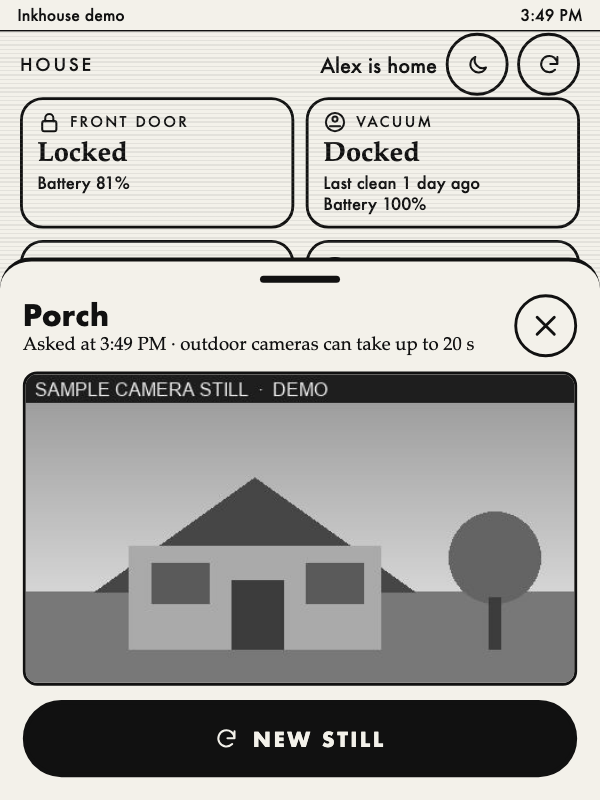 |

## Why

An old Kindle makes a great wall or bedside panel: it costs almost nothing, lasts weeks on a charge, and doesn't light up the room. Ready-made Kindle dashboards for Home Assistant are mostly pictures of a dashboard you can't touch. Inkhouse is built for touch from the start, and it is designed around e-ink instead of shrinking a phone UI onto it.

## Features

- **Three pages:** Control (AC tiles, all AC off, door, vacuum, dishwasher, routines), House (door, vacuum, garden, Wi-Fi, cameras, dishwasher, alerts) and Energy (AC energy today, room temperatures and humidity).
- **Room sheet:** big setpoint with − / + buttons in the AC's own step (for example 0.5°), mode and fan speed.
- **Usual settings:** the vacuum and dishwasher sheets underline the settings you normally use, so one tap starts your usual run. A vacuum app shortcut can be its own button.
- **Alerts:** AC left on too long, NAS too hot, low lock battery, internet down, vacuum maintenance due, with a reset button where it makes sense.
- **Camera stills on tap,** resized by Home Assistant to about 15–20 KB.
- **Made for e-ink:** black, paper and one gray. No animation (no ghosting). Every tap target is at least about 10 mm. Idle clock after 2 minutes. Night mode.
- **Fast:** the page is one file, about 14 KB compressed. State updates are about 1.5 KB and arrive within a second of a change (long polling). Taps show "sending" at once, then Home Assistant confirms.
- **Kindle-proof:** plain ES5 JavaScript for the Kindle's old browser. Times are shown in Home Assistant's time zone even though the Kindle browser runs on UTC.

## How it works

```
Kindle browser  ──HTTP──▶  Inkhouse proxy (Node, no dependencies)  ──WebSocket──▶  Home Assistant
   page + taps              holds the token, allow-list, cache                     states, services
```

The Kindle never sees your Home Assistant token. The proxy:

- reads only the entities listed in `config.json` and sends the panel a few attributes of each;
- performs only the actions `config.json` allows for each entity (`power`, `temperature`, `hvac_mode`, `fan_mode`, `lock`, `unlock`, `start`, `dock`, `select`, `switch`, `number`, `press`, `run`);
- checks select options against Home Assistant, clamps temperatures and limits tap rate;
- blocks cross-site requests (custom header on actions) and DNS rebinding (IP-address hosts only by default);
- can require a panel key, and has a dry-run mode that logs actions instead of sending them.

## Setup

### 1. Home Assistant
Create a non-admin user for the panel (Settings → People → Add person, allow login), log in as it once and create a long-lived token (Profile → Security).

### 2. The proxy
Needs Node 22+ or Docker, on any machine on your network (a NAS works well).

```sh
cp .env.example .env                 # set HA_URL and HA_TOKEN; keep DRY_RUN=1 for the first run
cp config.example.json config.json   # list your entities (see below)
```

Docker: `docker compose up -d` (uses `compose.yaml`). Or without Docker: `set -a; . ./.env; set +a; node server.js`.

Open `http://<server-ip>:8190/health`; it should say `"ha":true`. Then set `DRY_RUN=0`. With Docker, recreate the container after changing `.env` (a restart keeps the old values).

### 3. The Kindle
Any jailbroken Kindle with a browser (see [kindlemodding.org](https://kindlemodding.org/)). Developed on a Kindle Paperwhite 4 (10th gen), firmware 5.18.1.

- **Quick:** open the Kindle's web browser at `http://<server-ip>:8190/`.
- **Full screen:** copy `kindle/inkhouse.sh` and `kindle/inkhouse_stop.sh` to the Kindle's `documents/` folder, set `PANEL_URL` in `inkhouse.sh`, and open **Inkhouse** from the library. It hides the Kindle UI, opens the panel in the built-in browser with no toolbar, and keeps the screen awake. Press the power button to leave; the Kindle home screen takes up to a minute to come back. **Inkhouse - stop** is a rescue if that ever fails (or hold power about 40 seconds to restart).

## Configuration

`config.json` has three parts. `config.example.json` is a complete example.

- `read`: extra entities to show (sensors and so on).
- `control`: entity → list of allowed actions. Anything not listed here can't be changed from the panel.
- `ui`: what goes where: `rooms` (name, climate, hours and humidity sensors, alert hours), `lock`, `vacuum` (settings with their usual value, sensor reset, shortcut), `dishwasher` (program selects, options, start times, usual program), `routines`, `garden`, `wifi`, `nas`, `cameras`, `energy`, alert thresholds, and `labels` to rename raw option values (for example `"Map 1": "Downstairs"`).

Sections you leave out disappear from the panel.

## Design

The panel was designed with clickable mockups before any code, drawn to the Kindle's real size:

- [First options](https://kingstonbenjamin.github.io/inkhouse/mockups/first-options.html): browser tiles versus a KOReader plugin.
- [Design mockup](https://kingstonbenjamin.github.io/inkhouse/mockups/design.html): the interactive mockup the real page was built from.

Ideas borrowed from popular Home Assistant dashboards: Mushroom (the icon toggles, the card opens details), Bubble Card (bottom navigation and pop-up sheets) and Minimalist UI (rounded cards with one short state line).

## Project layout

```
server.js            proxy (HTTP + Home Assistant WebSocket)
public/index.html    the panel (HTML, CSS, ES5, SVG icons in one file)
config.example.json  example config
compose.yaml         Docker
kindle/              full-screen launcher scriptlets
demo/                sample data and a fake proxy for the demo
tools/build-demo.mjs builds docs/demo from public/index.html
docs/                GitHub Pages: demo, mockups, screenshots
```

## Credits

The full-screen launcher's approach (stop the Kindle UI, run the built-in `kindle_browser` without its toolbar) comes from [kindle-shortcut-browser](https://github.com/mitchellurgero/kindle-shortcut-browser) by mitchellurgero. `kindle/inkhouse.sh` is a smaller rewrite that restores the Kindle UI on exit and keeps the screen awake.

## License

[MIT](LICENSE). Kindle is a trademark of Amazon; this project is not affiliated with Amazon or Home Assistant.
